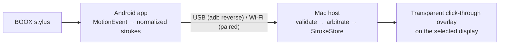

# InkBridge

Use a **BOOX** e-ink tablet (target: Note Air 3; tested on a Note Air 2 Plus) as a pen tablet for macOS. Write on the tablet, and your
strokes stay on the tablet **and** appear as native vector ink **over whatever is on the Mac's screen**: videos,
PDFs, browsers, Figma, slides. The overlay is click-through, so the app underneath
keeps working.

InkBridge does not mirror the screen. The tablet sends pen samples (normalized
position, pressure, time). The Mac renders them in a transparent overlay. It uses
about 30 KB/s while drawing, keeps ink editable, and runs entirely on your local
network or USB cable.

> **Status: Phase 0/1 (developer preview).** Protocol, Mac host, overlay, tools,
> sessions, shared infinite canvas and Android client are implemented. **Verified on a real BOOX Note Air 2 Plus
> over USB:** 360 Hz pen input with full pressure, tilt and hover; pen-to-Mac latency
> p50 5 ms / p95 16 ms. See the [feasibility report](docs/research/hardware-feasibility.md). USB currently needs
> USB debugging (`adb reverse`). A no-developer-mode USB transport (Android Open
> Accessory) is the next milestone; the device's support for it is confirmed.



## Quick start

```bash
# Mac host
make -C apps/macos run

# Tablet: enable USB debugging (Settings → About → tap Build number 7×), then
make -C apps/android install
scripts/adb-usb.sh --watch      # keeps the USB tunnel up across replugs
```

**Wi-Fi (default, no cable):** on the Mac choose menu-bar pen → Connect Device… (⌃⌥K).
On the tablet tap Connect to Mac, pick the Mac and type the one-time code. After that
it reconnects by itself. USB is optional. Details:
[setup](docs/implementation/setup.md).

No tablet yet? `scripts/e2e.sh` runs the Kotlin client against the Swift host with a
simulated pen.

## Features

| | |
|---|---|
| Canvas | infinite and shared: zoom (pinch, ±) and pan (finger) on the tablet, Fit all / Home on both; ink persists on the tablet |
| Tools | pen (pressure), highlighter, stroke eraser, laser pointer, colors, widths |
| Editing | undo/redo of whole strokes; clear is undoable |
| Overlay | transparent, click-through, above full-screen apps, any display |
| Toolbar | expanded / compact / minimal; bottom, top, left, right or anywhere; hide, then reopen from the menu-bar icon |
| Shortcuts | ⌃⌥ P/H/E/L tools · Z undo · ⇧Z redo · C clear · F fit · 0 home · O hide · S save · T toolbar |
| Sessions | autosave every 5 s, crash recovery; **Save…** to any folder: full page (PNG/JPEG), transparent ink layer (PNG + SVG), editable strokes, background, mapping metadata |
| Connection | Wi-Fi first: Bonjour discovery, TLS with a pinned certificate, one-time pairing code (or QR link), device tokens; reconnect 163 ms after Wi-Fi returns; strokes lost on a dead link are re-sent. Optional USB (adb reverse) |
| Tablet app | E-ink-first UI: dashboard, Connect to Mac, full-screen canvas with a slim floating bar, Settings, Diagnostics |
| Diagnostics | live RTT and pen-to-Mac latency; exportable report; on-tablet stylus readout |

## Repository

```
apps/android/     Kotlin: :core (protocol, input, transport, client; pure JVM), :app, :simulator
apps/macos/       Swift: InkBridgeCore (library), InkBridge.app, inkbridge-probe
protocol/fixtures shared test vectors, used by both test suites
tools/aoa-probe   USB Android-Open-Accessory capability probe (C, libusb)
scripts/          e2e.sh, adb-usb.sh
docs/             research, architecture, protocol, ADRs, diagrams
```

## Tests

```bash
make -C apps/macos test     # 87 Swift tests (unit, socket and TLS integration)
make -C apps/android test   # 56 Kotlin core + 9 Robolectric UI tests
scripts/e2e.sh && scripts/e2e.sh wifi
```

## Known limitations

- USB needs developer mode for now (AOA transport planned; see ADR-002).
- Wi-Fi is authenticated but **not encrypted** yet. Use it on trusted networks (see
  [security](docs/architecture/security.md)).
- There is no calibration wizard, session history browser or onboarding flow yet.
- The tablet doesn't show the Mac's screen. That's by design.
- Wi-Fi from the real tablet, eraser-end pens and the Note Air 3 itself are not yet tested.
- The tablet shows ink in monochrome (e-ink); colours appear on the Mac.

## Documentation

Start at [docs/README.md](docs/README.md).
