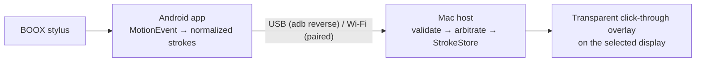

# InkBridge

Use a **BOOX Note Air 3** as a pen tablet for macOS. Write on the tablet, and your
strokes appear as native vector ink **over whatever is on the Mac's screen**: videos,
PDFs, browsers, Figma, slides. The overlay is click-through, so the app underneath
keeps working.

InkBridge does not mirror the screen. The tablet sends pen samples (normalized
position, pressure, time). The Mac renders them in a transparent overlay. It uses
about 30 KB/s while drawing, keeps ink editable, and runs entirely on your local
network or USB cable.

> **Status: Phase 0/1 (developer preview).** Protocol, Mac host, overlay, tools,
> sessions and Android client are implemented and tested end to end with a simulated
> tablet. Verification on the real Note Air 3 is in progress. See the
> [feasibility report](docs/research/hardware-feasibility.md). USB currently needs
> USB debugging (`adb reverse`). A no-developer-mode USB transport (Android Open
> Accessory) is the next milestone; the device's support for it is confirmed.



## Quick start

```bash
# Mac host
make -C apps/macos run

# Tablet: enable USB debugging (Settings → About → tap Build number 7×), then
make -C apps/android install
scripts/adb-usb.sh --watch      # keeps the USB tunnel up across replugs
```

Open InkBridge on the tablet and draw. For Wi-Fi, open Settings on the tablet, pick
Wi-Fi, and enter the pairing code from the Mac's menu bar. Details:
[setup](docs/implementation/setup.md).

No tablet yet? `scripts/e2e.sh` runs the Kotlin client against the Swift host with a
simulated pen.

## Features

| | |
|---|---|
| Tools | pen (pressure), highlighter, stroke eraser, laser pointer, colors, widths |
| Editing | undo/redo of whole strokes; clear is undoable |
| Overlay | transparent, click-through, above full-screen apps, any display |
| Shortcuts | ⌃⌥ P/H/E/L tools · Z undo · ⇧Z redo · C clear · O hide · S save · T toolbar |
| Sessions | autosave every 5 s, crash recovery, save as vector JSON + PNG + PDF, optional screenshot background |
| Connection | USB (adb reverse) or Wi-Fi (Bonjour + pairing code); auto-reconnect < 3 s; USB preferred when both are present |
| Diagnostics | live RTT and pen-to-Mac latency; exportable report; on-tablet stylus readout |

## Repository

```
apps/android/     Kotlin: :core (protocol, input, transport, client; pure JVM), :app, :simulator
apps/macos/       Swift: InkBridgeCore (library), InkBridge.app, inkbridge-probe
protocol/fixtures shared test vectors, used by both test suites
tools/aoa-probe   USB Android-Open-Accessory capability probe (C, libusb)
scripts/          e2e.sh, adb-usb.sh
docs/             research, architecture, protocol, ADRs, diagrams
```

## Tests

```bash
make -C apps/macos test     # 62 Swift tests (unit + socket integration)
make -C apps/android test   # 33 Kotlin tests (unit + socket integration)
scripts/e2e.sh && scripts/e2e.sh wifi
```

## Known limitations

- USB needs developer mode for now (AOA transport planned; see ADR-002).
- Wi-Fi is authenticated but **not encrypted** yet. Use it on trusted networks (see
  [security](docs/architecture/security.md)).
- There is no calibration wizard, session history browser or onboarding flow yet.
- The tablet doesn't show the Mac's screen. That's by design.
- Hardware behaviour (pressure, report rate, eraser, latency) is still being measured.

## Documentation

Start at [docs/README.md](docs/README.md).
