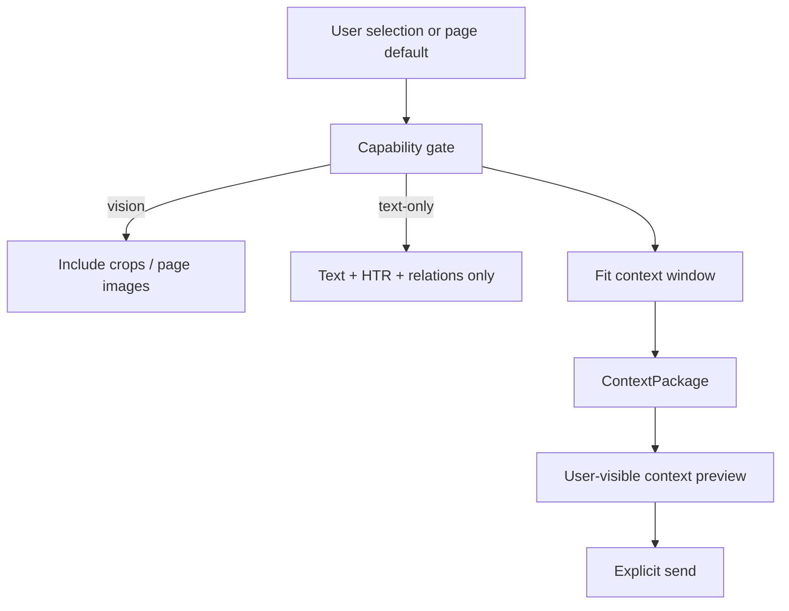

# AI Context Builder (proposed)

## Responsibility

Build a **structured context package** for a cloud provider or local agent from
the current document, page, or user selection — without dumping the entire
library into the model.

## Inputs

- Source: page text, optional page image / crop
- Ink: selected strokes (vector JSON) + optional ink raster overlay
- Semantic: HTR/OCR results, relations, user corrections
- User question + conversation history (bounded)
- Model capabilities (modalities, context window)
- Size budgets (tokens / bytes)

## Outputs (representations)

| Format | Use |
|--------|-----|
| Markdown | Claude Code / Cursor handoff, readable prompts |
| JSON | Structured tool input, tests |
| PNG/JPEG | Vision models, region crops |
| PDF (page subset) | Models that accept files; local agents via path |
| Provider-specific package | OpenRouter multimodal `messages` content parts |

## Selection and minimization



Rules:

1. Prefer **selection** over whole document.
2. Never silently strip provenance fields that the UI claims were sent.
3. If the package cannot fit, refuse or ask to narrow — do not invent summaries
   as if they were the original ink.
4. Context preview is mandatory before first cloud send in a session (configurable later).

## Suggested `ContextPackage` fields

```text
id, createdAt, documentId, pageIds[], region?,
sourceText?, sourceImages[],
inkStrokes[], inkOverlayImage?,
semantic[] (with confidence + provenance),
question, history[],
representations[], estimatedTokens?,
consent: { providerId, modelId, acknowledgedAt }
```

## Trade-offs

| Approach | Pro | Con |
|----------|-----|-----|
| Full page image only | Simple | Loses editable ink; costly |
| Text + HTR only | Cheap, private-ish | Misses diagram structure |
| Hybrid (default) | Matches vision/text models | More builder complexity |
