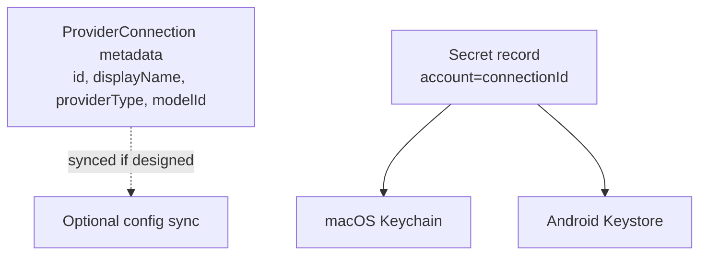

# Secure AI credential management (proposed)

Related: [ADR-012](../../decisions/ADR-012-secure-ai-credentials.md),
[../security.md](../security.md).

## Requirements

- Never store API keys in plaintext DB rows, documents, logs, Obsidian notes,
  exports, or sync payloads.
- **macOS:** Keychain (`kSecClassGenericPassword`, app-bound access group).
- **Android:** Keystore-backed encrypted storage (e.g. EncryptedSharedPreferences
  or equivalent).
- Keys never cross into WebView / untrusted JS.
- Redact secrets from errors and diagnostics.
- Replace / revoke credentials in UI.
- **Do not sync raw keys between devices.** Sync provider *metadata* only
  (name, provider type, default model id, enabled). Each device holds its own secret.

## Ownership model

`ProviderConnection` id is the Keychain account / Android alias. Deleting a
connection deletes the secret.

## Local agents

Prefer **CLI-native auth** when the user already logged in:

- Claude Code: existing subscription / CLI login; avoid forcing an Anthropic
  key into InkBridge for interactive Mac workflows. `--bare` automation may
  require `ANTHROPIC_API_KEY` — store separately only if user opts into bare
  automation.
- Cursor: `agent login` or user-supplied `CURSOR_API_KEY` in Keychain for
  headless runs.

## Backup / migration

Keychain items are not in project folders. Migration UX: “re-enter API key on
this device.” Never attempt to export raw keys into Dropbox-backed project dirs.

## Logging checklist

- [ ] No key in `os_log` / `Logcat`
- [ ] No key in crash reports
- [ ] HTTP client redacts Authorization
- [ ] Self-test / diagnostics scrubber
