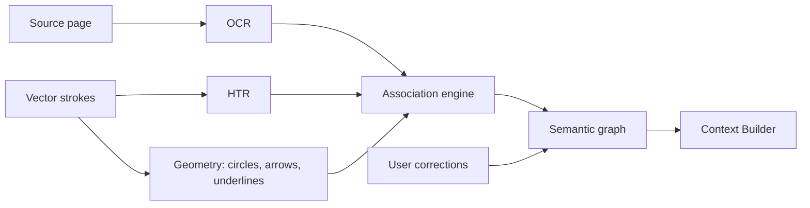

# Document intelligence — three layers (proposed)

Related: [ADR-013](../../decisions/ADR-013-three-layer-document.md).

## Why three layers

Flattening a page to a screenshot destroys editable ink and provenance. InkBridge
already treats strokes as first-class vectors. AI must respect that boundary:

| Layer | Owns | Must not |
|-------|------|----------|
| **Source** | Original PDF/pages/images/extracted text/structure | Be overwritten by AI summaries |
| **Ink** | Editable strokes, shapes, connectors, colors, timestamps | Be reduced solely to a bitmap |
| **Semantic** | HTR, OCR, spatial relations, AI interpretations, user corrections | Be treated as ground truth without confidence |

Every Semantic object carries provenance: `documentId`, `pageId`, `region`,
`strokeIds[]`, `sourceTextRefs[]`, `confidence`, `createdBy` (`user` | `htr` | `ocr` | `ai`).

## Source Layer (mostly future)

Proposed types:

- `DocumentIdentity` — stable id, content hash, title, importedAt
- `Page` — pageNumber, size in PDF points, optional rendered pixmap cache
- `TextRun` / `TextBlock` — extracted print text with boxes
- Optional web/screenshot imports as `SourceMedia`

**Today:** no PDF import viewer. Temporary demos may use a rasterized canvas
export or ScreenCaptureKit snapshot labeled as *surrogate source* in the UI.

## Ink Layer (largely implemented)

Reuse existing stroke/diagram models. Extend metadata only where needed for AI:

- page / canvas coordinate frame (already required for sync)
- stroke ordering and tool (pen/highlighter/eraser)
- grouping ids for “selection for AI”
- optional link anchors once Source pages exist

Do not invent a parallel stroke format for AI.

## Semantic Layer (proposed)

Pipeline sketch:

Capabilities to design for:

- Printed OCR and handwriting HTR (mixed pages)
- Text-region / layout detection
- Circle, underline, highlight detection from stroke geometry
- Arrow/connector interpretation (endpoints → concepts)
- Spatial association: note ↔ nearby paragraph
- Diagram / sketch structure (low confidence by default)
- Confidence scores and correction UI

### Accuracy posture

Do **not** ship fixed accuracy claims without an evaluation set. Document
failure modes: messy handwriting, low-quality scans, overlapping ink, dense
diagrams. UI must show confidence and allow correction; corrected text becomes
user-authored Semantic facts with higher trust.

## Annotation ↔ document relationships

Association engine inputs: ink bounding boxes, Source text boxes, stroke
direction for arrows. Outputs: `Relation` edges (`refersTo`, `highlights`,
`connects`, `groups`). Ambiguous links stay `proposed` until user confirms.

Coordinate accuracy must survive zoom/pan using the same mapping rules as
[coordinate-mapping](../coordinate-mapping.md).
