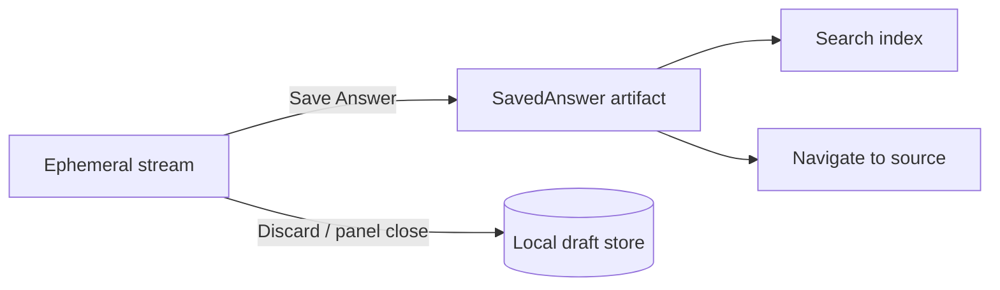

# AI Knowledge Library & Save Answer (proposed)

## Principle

Saving is an **explicit** user action unless the user enables automatic saving.
Streaming drafts are conversation-local until saved.

## Save destinations

- Current document / PDF page
- Daily Journal day
- Dedicated AI Notes collection
- User-selected knowledge folder

## Saved answer model

| Field | Notes |
|-------|-------|
| `answerId` | Stable UUID |
| `conversationId` | Thread |
| `question` | Original prompt |
| `responseOriginal` | Immutable model output |
| `responseEdited` | Optional user edits (distinguishable) |
| `provider`, `model` | Attribution |
| `createdAt`, `savedAt` | Timestamps |
| `documentId`, `pageIds` | Source links |
| `annotationIds` / `strokeIds` | Ink provenance |
| `contextRefs` | Package snapshot id / hash |
| `tags`, `destination` | Organization |

Opening a saved answer should navigate back to PDF page, region, annotations,
and optionally reopen the conversation.

## Management

Search; filter by document/date/provider/tags; edit; annotate with ink; link
answers; export Markdown/PDF; delete; reopen conversation.

## Sync

Persisted answers are ordinary knowledge artifacts (candidates for the same
storage story as journal/projects). Live streaming buffers are **not** sync
payloads by default.

