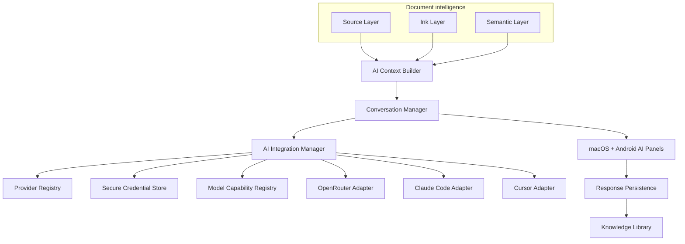

# AI-native overview (proposed)

## Product problem

Engineers and researchers annotate PDFs and notes on BOOX, then reconstruct
context by hand for ChatGPT, Claude, or Cursor. InkBridge already owns the
strokes and the Mac/tablet session. The product gap is an assistant that
**understands the same page** — source text, handwriting, circles, arrows —
and returns answers **inside** InkBridge, with an optional explicit save into
a durable knowledge library.

## Target workflow

1. Open a technical PDF (future Source layer) or the current canvas/journal page.
2. Annotate on BOOX (Ink layer — already implemented).
3. Open the AI panel; choose OpenRouter / Claude Code / Cursor.
4. Ask about the page, a region, or handwriting.
5. Context Builder packages selected Source + Ink + Semantic evidence.
6. Stream the answer in the Mac and/or BOOX AI panel.
7. Optionally **Save Answer** with provenance links (never silent auto-save).

## Implemented vs proposed (verified)

| Capability | Status |
|------------|--------|
| Vector strokes, sync, journal, engineering, export PNG/SVG/PDF | **Implemented** |
| Secure device pairing / TLS for ink transport | **Implemented** |
| PDF *import* / page viewer / document identity for papers | **Not implemented** |
| OCR / handwriting recognition / semantic relations | **Not implemented** |
| AI Context Builder | **Not implemented** |
| AI Provider Hub UI + OpenRouter client | **Not implemented** |
| Keychain/Keystore AI credential store | **Not implemented** |
| macOS / Android AI conversation panels | **Not implemented** |
| Knowledge Library / Save Answer | **Not implemented** |
| Claude Code / Cursor adapters | **Not implemented** |
| Cross-device AI session sync | **Not implemented** |

Partial foundations that AI will reuse:

- Editable stroke model + page coordinates (`Stroke`, canvas sync).
- Journal day identity and history.
- Layered export (useful as a temporary context surrogate).
- Design-system / e-ink UI patterns on Android.

## High-level architecture

## Design principles

1. **Provider-agnostic core** — document/ink types never import vendor SDKs (ADR-011).
2. **Secrets stay on-device** — Keychain / Keystore; never sync raw API keys (ADR-012).
3. **Three layers with provenance** — Source / Ink / Semantic (ADR-013).
4. **Explicit cloud send** — user consent before any external upload.
5. **Explicit save** — answers are ephemeral until Save Answer.
6. **E-ink first on Android** — compact controls, minimal animation/refresh.
7. **Honest uncertainty** — HTR/OCR confidence; never present guesses as facts.

## Failure modes (architecture level)

| Failure | Handling principle |
|---------|-------------------|
| Invalid / revoked API key | Fail closed; clear UI; no retry storm |
| Model lacks vision | Downgrade package to text + HTR; warn |
| Context too large | Minimize / region-select; refuse silent truncation of provenance |
| CLI missing / unauthenticated | Disable adapter with actionable message |
| Network drop mid-stream | Keep partial draft; Retry; do not auto-save |
| Sync of AI sessions | Device-local drafts until persisted artifact sync is designed |

## Unresolved decisions

- Source-of-truth for multi-device live conversations (Mac-primary vs CRDT).
- Whether early vertical slice uses canvas PNG before PDF import.
- On-device vs cloud HTR for Semantic Layer v1.
- Cursor path: CLI subprocess vs embedding `@cursor/sdk` (requires Node bridge).
