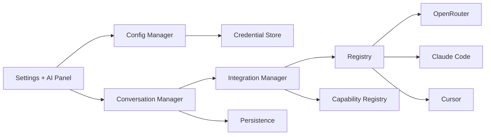
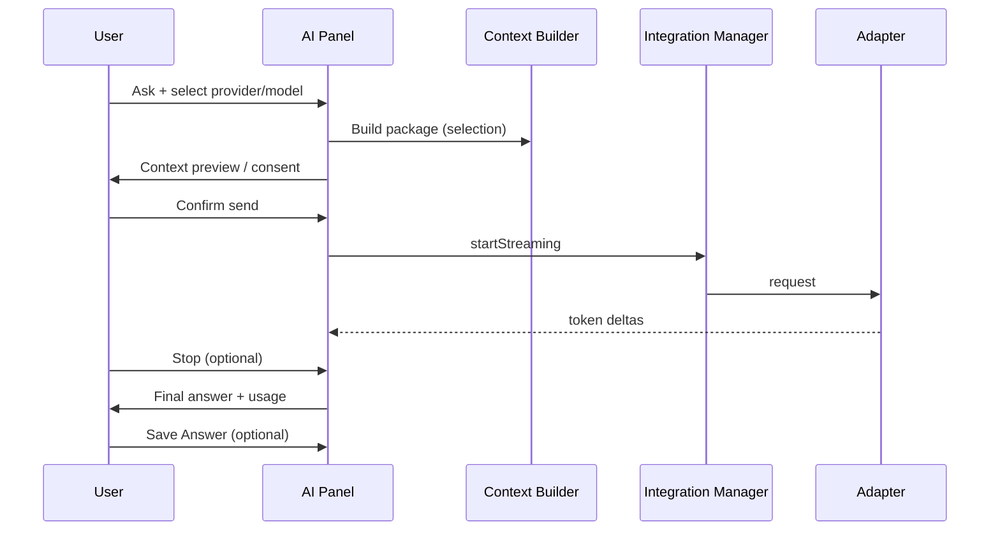

# AI Provider Hub (proposed)

## Goal

A polished in-app hub so users configure providers **without** editing config
files or using the terminal for cloud keys. Local agents remain discoverable
separately (CLI presence / auth status).

## Components

| Component | Role |
|-----------|------|
| `AIIntegrationManager` | Orchestrates send/stream/cancel |
| `ProviderRegistry` | Registered adapters (`AIProvider`, `LocalAgent`) |
| `ProviderConfigurationManager` | Named connections, defaults, enable/disable |
| `SecureCredentialStore` | Keychain / Keystore ([credentials.md](credentials.md)) |
| `ModelCapabilityRegistry` | Modalities, context, pricing metadata |
| `ConversationManager` | Threads, streaming state, stop/retry |
| `ResponsePersistenceService` | Explicit Save Answer |
| Cloud / local adapters | OpenRouter, Claude Code, Cursor, … |

## Configuration UX (Mac + Android)

1. AI Settings → Add Provider → OpenRouter  
2. Name + API key → Validate → pick model → Save  
3. Cards show status, default flag, last test result  

Must match existing InkBridge settings visual language; avoid developer noise
in the default path. Advanced options (routing, fallbacks) behind disclosure.

## Conversation lifecycle

Support: streaming where available, history, stop, retry, model switch,
context preview, usage display, provider/model attribution per message.

## Usage and cost

When the provider returns `usage` (prompt/completion tokens), show those
numbers. Estimate cost only from **listed** model pricing × tokens. Label
estimates as estimates. Never invent billing totals.

## Response destinations

- macOS AI panel (side panel / contextual)
- Android / BOOX AI panel (independent — Mac not required)
- Current device (default)
- Both devices — only after a defined sync model for conversation drafts

Answers must not vanish solely because a panel closed; drafts stay in local
conversation store until deleted or saved to the Knowledge Library.
