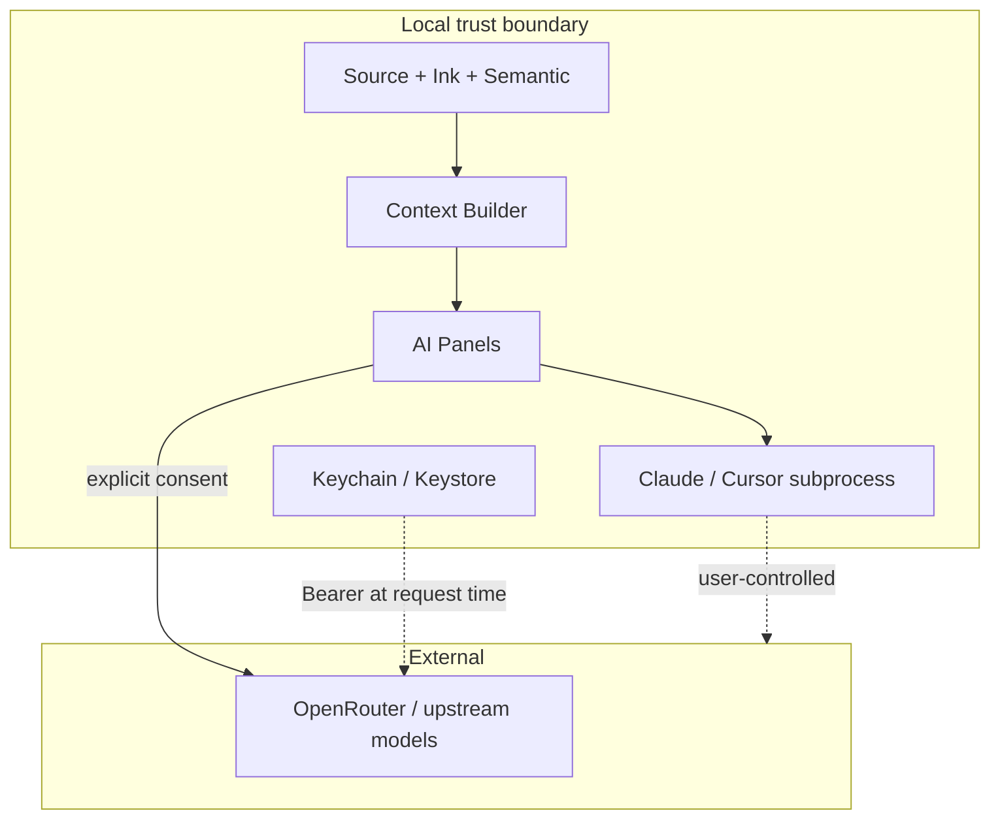

# AI security and privacy (proposed)

Builds on [../security.md](../security.md) (transport/pairing). This document
covers **document content egress** and **provider credentials**.

## Trust boundaries

## Rules

1. **Local-first** processing for OCR/HTR when practical; cloud HTR is optional and labeled.
2. **Explicit consent** before sending content to external providers; show provider + model.
3. **No silent uploads**; unrelated documents stay out of the package.
4. **User-controlled selection** and context preview.
5. **Secure IPC / subprocess** for local agents; no credential leakage in argv when avoidable.
6. **Retention:** conversation drafts deletable; saved answers follow user delete; configurable later.
7. **Separate** local processing, cloud inference, and local agent execution in UX copy.

## Data that must never leave the device without consent

- Raw API keys  
- Full library / other projects not in selection  
- Pairing secrets / device tokens (existing security.md)  

## Threat notes

| Threat | Mitigation |
|--------|------------|
| Key exfiltration via logs | Redaction; Keychain-only |
| Prompt injection via malicious PDF text | Treat Source as untrusted input to agents; restrictive tools |
| Agent writes unexpected files | Default read-only; confirm write mode |
| Sync leaking keys | Metadata-only sync |
