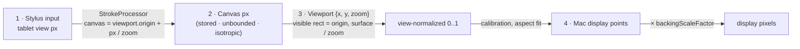

# Coordinate mapping

Four coordinate spaces ([ADR-006](../decisions/ADR-006-infinite-canvas-and-sync.md)).
Only **canvas px** are ever stored.



| Space | Unit | Code | Stored? |
|---|---|---|---|
| Stylus input | tablet view px, top-left of the drawing view | `MotionEvent` → `RawSample` | no |
| **Canvas** | **canvas px**: 1 = 1 tablet px at zoom 1; y down; unbounded | `InkPoint` (Kotlin + Swift) | **yes** |
| Viewport | canvas point at the view's top-left, plus `zoom` (view px per canvas px) | `Viewport` (both sides) | session metadata only |
| Mac display | AppKit points on the selected display, top-left | `CoordinateMapper` | no |

## 1. Input → canvas (tablet)

`StrokeProcessor` reads the current `viewport` for every sample:

```
canvasX = viewport.x + viewX / viewport.zoom
canvasY = viewport.y + viewY / viewport.zoom
```

Values are rounded to 0.01 canvas px. Because canvas px are isotropic (the same unit
on both axes), **rotating the tablet cannot distort existing strokes**, which v1's
per-axis normalization could.

## 2. Viewport (both sides, kept in sync)

- Home view `{0, 0, 1}`: canvas px = tablet px, so the Mac overlay lines up 1:1 with
  the screen, exactly as before.
- Zoom: `zoomedBy(factor, focus)` keeps the canvas point under the fingers (or the view
  centre) fixed. Zoom is clamped to 0.02 … 50.
- Pan: `pannedBy(dx, dy)` moves the content with the finger.
- Fit all: `fitting(contentBounds, viewSize, margin 5 %)`.
- The tablet is the usual source of view changes. The Mac follows through
  `canvas.viewport`. Mac-side *Fit all* and *Home* send the new view back. Last writer
  wins.

Zooming and panning **never modify stroke data**. They change only the mapping, so
there's nothing to corrupt (tested: `testZoomingOutShowsMoreCanvasWithoutChangingStrokeData`,
`testPanningMovesTheViewNotTheInk`).

## 3. Canvas → Mac display

```
visible = (viewport.x, viewport.y, surface.w / zoom, surface.h / zoom)     // canvas px
u = (canvasX − visible.x) / visible.w,  v = (canvasY − visible.y) / visible.h
u' = (u − cal.offsetX) · cal.scaleX,     v' = (v − cal.offsetY) · cal.scaleY
display = activeRect.origin + (u', v') · activeRect.size
```

- `activeRect` is the tablet view aspect-fitted (default) or stretched onto the
  selected display.
- `scale` (display points per canvas px) converts stroke widths, so ink thins when you
  zoom out, like a real page.
- Points are **not clamped**: off-screen ink is simply culled.
- `unmap` is the exact inverse (tested).

The full transform is written into every export as `session/coordinate-mapping.json`,
so other tools can place the strokes on the full-page image.

## Widths

The toolbar width is chosen in **on-screen points**. A new stroke stores
`width / scale` canvas px, so it looks exactly as thick as chosen at the zoom it was
drawn at, and scales consistently afterwards.

## Multiple displays

Unchanged from v1. The overlay sits on the chosen `NSScreen`, and the mapper is
rebuilt on display changes. Since strokes are canvas px, nothing is lost when a
display changes size or disappears.

## Calibration

The `Calibration` (offset and scale in view-normalized space) is applied after the
viewport, so it corrects the physical alignment at every zoom level. The 4-point wizard
is still not implemented.
