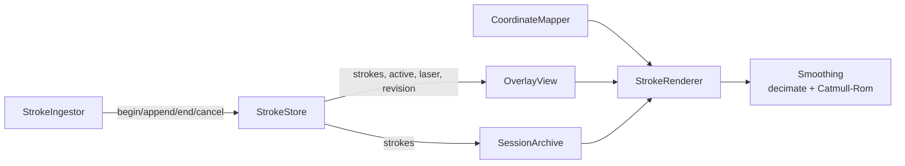

# Drawing engine

Everything lives in `InkBridgeCore/Drawing` with no AppKit dependency. The overlay
view, PNG export and PDF export all draw through the same `StrokeRenderer`.

The brief suggested `StrokeManager`, `StrokeBuffer`, `BrushEngine`,
`EraserEngine`, `SmoothingEngine` and `CoordinateMapper`. In practice the stroke
model, history and eraser need the same data and the same invariants, so they are one
type (`StrokeStore`). Brush behaviour is a style plus one width function, so it lives
in `StrokeRenderer`. Separate engine objects would mostly forward calls to each other.

## Model

- `Stroke { id, tool, style, points: [InkPoint] }`. Points are **canvas px** on an
  infinite canvas (ADR-006), independent of the zoom, pan, display and fit. Only the
  `CoordinateMapper` changes when the view does.
- `StrokeStyle { color, width (canvas px), pressureSensitive }` is captured at
  `stroke.begin`. Widths scale with zoom; the toolbar width is converted from on-screen
  points at the zoom the stroke starts at.
  Changing the toolbar later does not restyle ink already on screen.
- `StrokeStore` holds:
  - `strokes`: committed, in z-order
  - `active[id]`: strokes in progress (several are possible, keyed by ID)
  - `laser`: finished laser strokes with their end times. They fade over 1.2 s and are
    never undoable.
  - `revision`: bumped whenever `strokes` changes; used to invalidate the cache.

## Undo and redo

Every visible change is one `Command`:

| Command | Undo | Redo |
|---------|------|------|
| `add(stroke)` | remove the stroke | append it again |
| `erase([(index, stroke)])` | reinsert in reverse order of removal at the recorded indices (restores exact z-order) | remove by ID |
| `clear([strokes])` | restore all | remove those IDs |

Any new command clears the redo stack. **Clear is undoable**, so clearing the canvas
never destroys work. A cancelled eraser gesture rolls back what it had erased so far.

## Eraser

Stroke eraser: touching a stroke removes the whole stroke. Hit testing is
**segment against segment**. Each eraser segment (previous sample → current sample)
is tested against each stroke segment, with an intersection test plus endpoint
distances. An earlier point-only version missed thin lines whenever a fast swipe put
two samples on either side of the line; `testFastSwipeBetweenSamplesStillErases`
is the regression test for that.

Distances are measured in canvas px, which are isotropic, so the eraser is round.
The toolbar's eraser size (a fraction of the display height) is converted to canvas px
at the current zoom. A bounding-box precheck skips
most strokes.

A pixel/partial eraser (splitting strokes) is not implemented.

## Culling

On an infinite canvas most ink can be off-screen. `StrokeRenderer.draw` skips strokes
whose display bounds miss the context's clip rect, and so does the SVG writer. The
tablet renderer culls against the viewport the same way.

## Document sync

The Mac's `StrokeStore` is the document of record. `DocumentSync` mirrors it to the
tablet by ID diffs (`Session/DocumentSync.swift`). See
[ADR-006](../decisions/ADR-006-infinite-canvas-and-sync.md) and the protocol §5.

## Smoothing

1. **Decimation**: drop samples closer than 0.75 pt to the previous kept one, always
   keeping the last sample. The digitizer reports near-duplicates when the pen moves
   slowly. They add cost and produce kinks in the tangents.
2. **Uniform Catmull-Rom → cubic Bézier**: the segment Pᵢ → Pᵢ₊₁ uses control points
   `Pᵢ + (Pᵢ₊₁ − Pᵢ₋₁)/6` and `Pᵢ₊₁ − (Pᵢ₊₂ − Pᵢ)/6`, mirroring the endpoints.

Catmull-Rom **interpolates**: the curve passes through every sample. It never
trails behind the pen tip the way a moving-average or One-Euro filter does, so it adds
smoothness without adding latency. The only revision is that the last span re-curves
once the next sample arrives, which the dirty rect accounts for.

## Brushes

| Tool | Width | Opacity | Notes |
|------|-------|---------|-------|
| Pen | `width × (0.3 + 0.7·p)` if the device reports pressure, else `width` | 1 | one stroked path per segment (Core Graphics strokes a path at a single width); round caps hide the joins |
| Highlighter | fixed (8–48 pt, default 22) | adjustable, default 0.35 | one path for the whole stroke, so overlapping segments do not darken |
| Laser | 5 pt | fades 1 → 0 over 1.2 s | red with glow; not saved |
| Eraser | — | — | not drawn |

## Performance

| Measurement (Apple Silicon, `swift test` debug build) | Result |
|----|----|
| Deframe + decode + validate one `stroke.point` (2 samples) | 8.5 µs |
| Map one point | 94 ns |
| Render a 2 000-point pressure stroke into a 2× bitmap | 7.2 ms |

Live drawing renders only the active stroke within a small dirty rect, plus a blit of
the cached bitmap. The 7 ms full render is paid only when the cache is rebuilt
(stroke end, undo, erase). Metal is **not** justified by these numbers. Revisit it
only if profiling shows cache rebuilds stalling with very large sessions.

## Background layer (Phase 1)

The background is a separate layer drawn before strokes and never cached with them.
`BackgroundRenderer` (Swift) and `CanvasRenderer.drawBackground` (tablet) share the
pattern spacings. See [background-rendering.md](background-rendering.md) and
[shared-drawing-model.md](shared-drawing-model.md).
