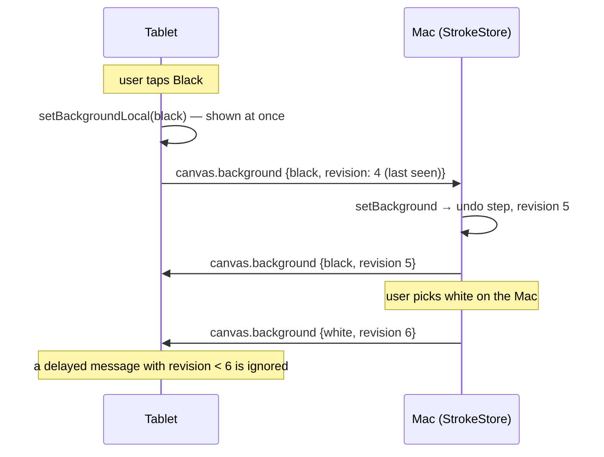

# Drawing synchronization

| What | Message | Direction | Ordering |
|---|---|---|---|
| Strokes | `stroke.begin/point/end/cancel` | D→H (device strokes), H→D (Mac strokes, resync) | Per-stream sequence; Mac drops duplicates; lost messages re-sent after reconnect (`resume_sequence`) |
| Stroke look | `stroke.style` | H→D | Follows its `stroke.begin` |
| Document edits | `canvas.command` (undo/redo/clear) | D→H | Applied on the Mac; the result goes back as `doc.remove` / strokes / `canvas.background` |
| Removal / resync | `doc.remove`, `doc.reset` | H→D | Diffs from `DocumentSync`; full resync on connect |
| View | `canvas.viewport` | both | Last writer wins (the view is not document data) |
| **Background** | **`canvas.background`** | **both** | **Revision**, see below |

## Background: single writer with revisions

- The tablet's request is always answered, even when nothing changed. So an optimistic tablet state that lost a race is corrected by the Mac's answer.
- Undo or redo on either side changes the background through the Mac's command history and is sent with a new revision.
- On (re)connect the Mac sends its current background with the resync. A request queued offline is delivered after it, so the tablet's latest choice wins, which is what the user did last.
- Tested by `BackgroundTest` (Kotlin: stale revisions ignored, local choice overridden by a newer answer) and `BackgroundTests` (Swift). End to end over TLS with a drop and reconnect: `scripts/e2e.sh wifi` (tablet → black = revision 1, Mac → white graph = revision 2, re-sent after reconnect without conflict).
