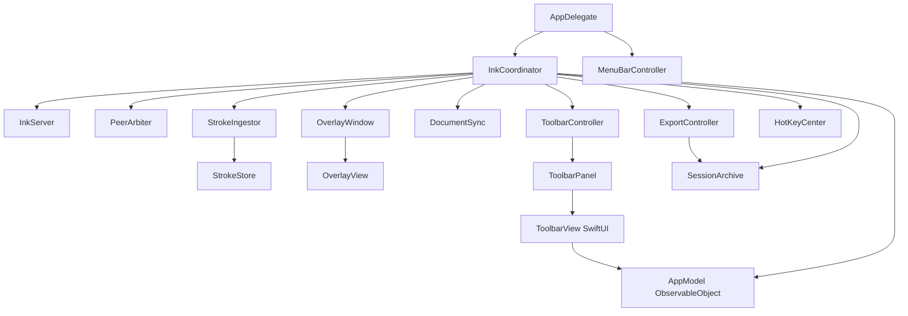

# macOS architecture

A Swift package (`apps/macos/Package.swift`) with three products:

| Target | Kind | Contents |
|--------|------|----------|
| `InkBridgeCore` | library | `Protocol/`, `Transport/`, `Drawing/`, `Session/`, `Storage/`. No AppKit, so it is testable headless. |
| `InkBridge` | executable → `InkBridge.app` | `App/`, `Features/{Overlay,Toolbar,Export,Settings}`, `Infrastructure/{HotKeys,ScreenCapture}` |
| `inkbridge-probe` | executable | headless host for end-to-end and latency tests |

It is SwiftPM rather than an `.xcodeproj` so it builds and tests from the command line
(`make test`, `make app`), and the diff stays readable. `scripts/build-app.sh` wraps
the binary in a bundle with `Info.plist` (LSUIElement, Local Network and Bonjour
declarations) and an ad-hoc signature.

Build output goes to `~/Library/Caches/InkBridge/macos-build`. The repository lives
in Dropbox, which attaches extended attributes that make `codesign` fail
("resource fork, Finder information, or similar detritus not allowed").

## App structure



- `AppModel` holds the UI state (tool, colors, widths, connection status, latency) and
  the persisted preferences (Wi-Fi on/off, transport preference,
  display, fit, screenshot opt-in).
- `InkCoordinator` is the only place where the server, the drawing model and the
  windows meet. It implements `InkServerDelegate` and `ToolbarActions`. After every
  document change it calls `syncDocument()`, which sends the tablet `DocumentSync`'s
  diff.
- `ToolbarController` owns the toolbar: size (expanded/compact/minimal), dock
  (bottom/top/left/right/floating), and visibility, all persisted.
- `ExportController` runs Save…: screenshot first, then the `NSSavePanel` with
  options, then `SessionArchive.export`, then an alert.
- `MenuBarController`: a left-click re-opens a hidden toolbar; otherwise it shows the
  menu.

UI details: [ui-specification.md](ui-specification.md).

## Overlay window

`OverlayWindow` is a borderless `NSWindow` configured like this:

| Setting | Value | Why |
|---------|-------|-----|
| `isOpaque` / `backgroundColor` | `false` / `.clear` | transparent |
| `ignoresMouseEvents` | `true` | **click-through**: the window server routes clicks, scrolls and drags to the window below |
| `level` | `.screenSaver` | above normal and full-screen app windows |
| `collectionBehavior` | `.canJoinAllSpaces, .fullScreenAuxiliary, .stationary, .ignoresCycle` | follows Space switches and appears in full-screen Spaces; not in ⌘` cycling |
| `canBecomeKey/Main` | `false` | never takes keyboard focus |

One overlay covers the **selected display** (Settings → Display; it falls back to the
main display if that one is unplugged). It is repositioned on
`didChangeScreenParametersNotification`.

`ToolbarPanel` is a separate `NSPanel` (`.nonactivatingPanel`, level
`screenSaver + 1`, movable by background, frame autosaved). Clicking it does not
activate InkBridge, so the annotated app keeps focus. Only the toolbar is
interactive.

Full-screen apps, Stage Manager, and Mission Control have not been tested on hardware
yet. See [`implementation/testing.md`](../implementation/testing.md).

## Rendering

`OverlayView` is flipped (top-left origin, matching the protocol):

1. If `StrokeStore.revision` changed, it re-renders committed strokes into a
   `CGImage` at backing scale (the cache).
2. Each `draw(_:)` blits the cache, then draws active strokes and fading laser trails.
3. A new point calls `setNeedsDisplay(dirtyRect)` with only the bounds of the new
   segment (plus two neighbouring samples, for the Catmull-Rom tangent update).

Details are in [`drawing-engine.md`](drawing-engine.md).

## Keyboard shortcuts

Carbon `RegisterEventHotKey`. Hot keys fire whichever app is frontmost and need
**no Accessibility permission**, unlike `NSEvent.addGlobalMonitorForEvents`.

| Shortcut | Action |
|----------|--------|
| ⌃⌥P / ⌃⌥H / ⌃⌥E / ⌃⌥L | pen / highlighter / eraser / laser |
| ⌃⌥Z / ⌃⌥⇧Z | undo / redo |
| ⌃⌥C | clear (undoable) |
| ⌃⌥O | hide/show ink |
| ⌃⌥S | save session |
| ⌃⌥T | hide/show toolbar |

## Logging and diagnostics

`os.Logger`, subsystem `app.inkbridge`, categories `server` and `coordinator`:

```bash
log stream --predicate 'subsystem == "app.inkbridge"' --level info
```

Device names are logged `.public`. Nothing about screen content or strokes is logged.
Menu → *Export Diagnostic Report* writes a text file (versions, listener state, peers,
RTT, latency percentiles, dropped-message count, displays) to
`~/Library/Application Support/InkBridge/Diagnostics/`.
