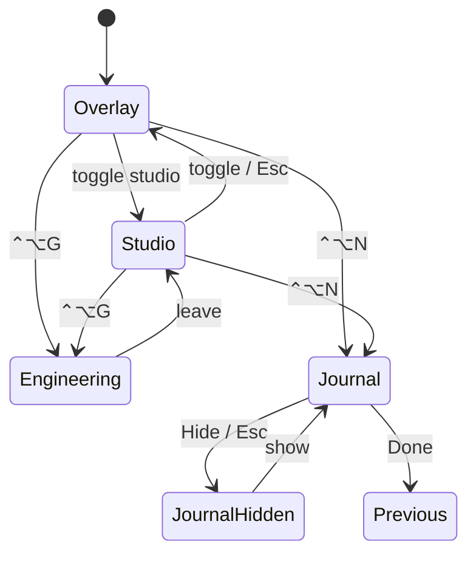

# Screen lifecycle and workspace state

macOS Overlay, Studio Canvas, Engineering, and Daily Journal share one derived
**Workspace** so window policy cannot contradict itself.

- Decision: [ADR-010](../decisions/ADR-010-workspace-state-machine.md)
- Implementation: `apps/macos/Sources/InkBridgeCore/Workspace/Workspace.swift`
- Interaction policy: [macos-interaction-model.md](macos-interaction-model.md)

## Priority

When resolving the active surface:

1. Journal (including put-away / hidden)
2. Engineering
3. Studio or Overlay from the document background

## Guarantees

- Overlay background is refused while Engineering or Journal owns the canvas.
- New/Open session is refused while the Journal day folder is the save target.
- Engineering forces pointer mode (diagram editing, not freehand).
- Esc hides the Journal or leaves Engineering before returning to Overlay.
- “Hide ink” orders the overlay window out (it does not leave a click-catching surface).
- Every mode transition cancels in-flight mouse / diagram gestures.

## Android notes

- `ConnectionManager` serialises client stop/start (no orphan connection loops).
- `CanvasActivity` uses `launchMode=singleTop`.
- Renderer bitmaps are recycled on detach.
