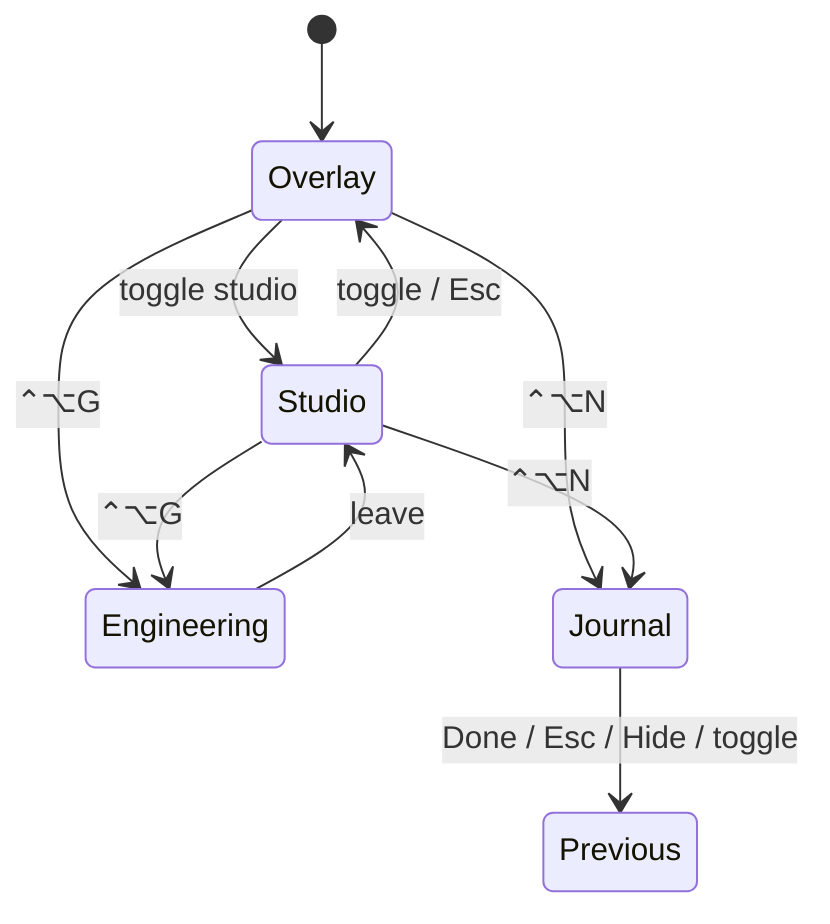
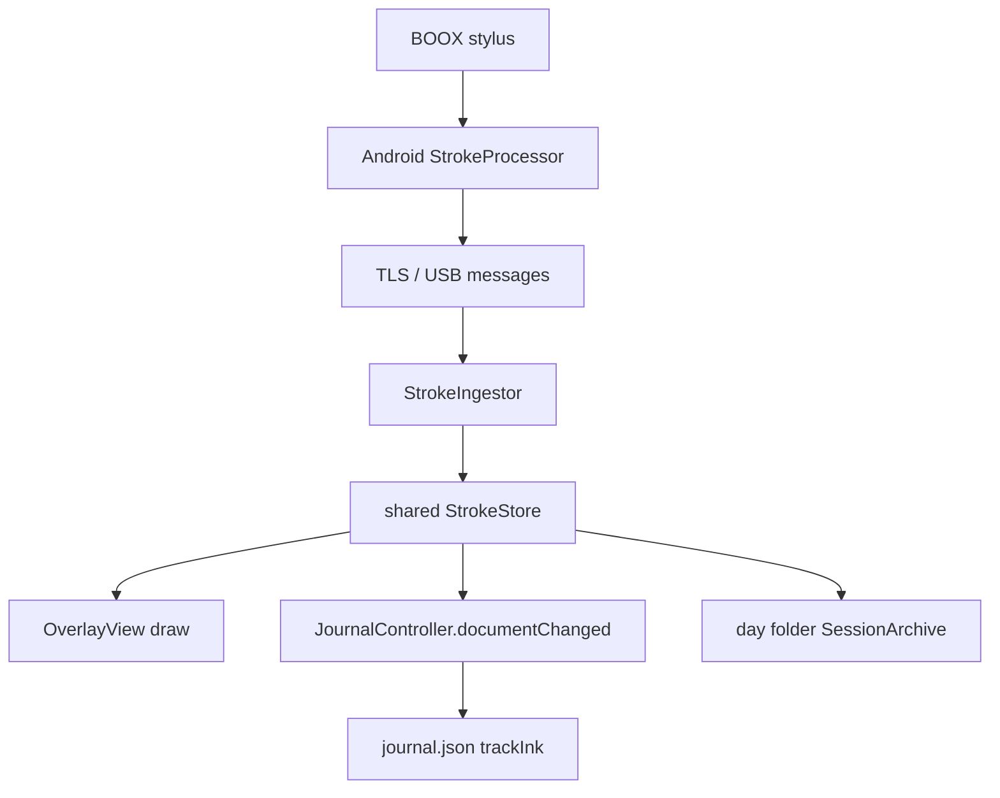

# Screen lifecycle and workspace state

macOS Overlay, Studio Canvas, Engineering, and Daily Journal share one derived
**Workspace** so window policy cannot contradict itself.

- Decision: [ADR-010](../decisions/ADR-010-workspace-state-machine.md)
- Implementation: `apps/macos/Sources/InkBridgeCore/Workspace/Workspace.swift`
- Interaction policy: [macos-interaction-model.md](macos-interaction-model.md)
- Journal: [Daily Journal](../design/daily-journal.md) (if present) · `JournalController.swift`

## Priority

When resolving the active surface:

1. Journal (while `journalActive`)
2. Engineering
3. Studio or Overlay from the document background

## Guarantees

- Overlay background is refused while Engineering or Journal owns the canvas.
- New/Open session is refused while the Journal day folder is the save target.
- Engineering forces pointer mode (diagram editing, not freehand).
- Esc / Done / panel close / ⌃⌥N toggle **leave** the Journal and restore the
  in-memory workspace snapshot (tool, viewport, strokes, Engineering).
- Opening or showing the Journal forces the canvas on-screen (`overlayVisible`,
  `orderFront`) so tablet ink is never routed into an ordered-out window.
- “Hide ink” (⌃⌥O) orders the overlay window out; Journal open clears that.
- Every mode transition cancels in-flight mouse / diagram gestures.

## Daily Journal stroke path

The Journal does **not** use a separate stroke store. If the overlay window is
ordered out, ingest and save still run but nothing is visible — that was the
root cause of “writing on BOOX does nothing on Mac” when Hide ink or the old
put-away mode left the canvas off-screen.

## Android notes

- `ConnectionManager` serialises client stop/start (no orphan connection loops).
- `CanvasActivity` uses `launchMode=singleTop`.
- Renderer bitmaps are recycled on detach.
- Tablet “Done — back to work” sends `journal.request close` (leave + restore).
