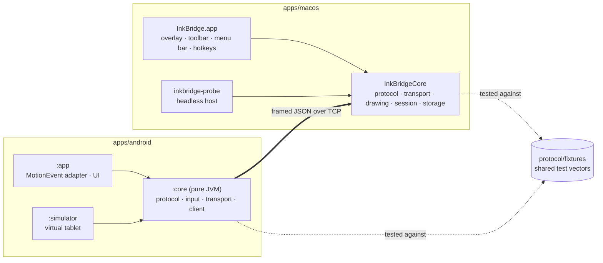

# System overview

InkBridge turns a BOOX Note Air 3 into a drawing tablet for macOS. The tablet
**captures** pen input and sends **stroke events**: normalized coordinates, pressure
and timestamps. The Mac **renders** them natively in a transparent, click-through
overlay above whatever is on screen. No pixels are streamed in either direction.

## Components

The full diagram is in [`diagrams/system-architecture.mmd`](../diagrams/system-architecture.mmd).

| Layer | Android | macOS | Knows about |
|-------|---------|-------|-------------|
| Input | `AndroidMotionEventSource`, `StrokeProcessor`, `CoordinateNormalizer` | — | MotionEvents, never sockets |
| Protocol | `MessageCodec`, `Framing`, `PairingAuth` | `MessageCodec`, `FrameCodec`, `PairingAuth` | bytes ↔ typed messages |
| Transport | `TcpTransport` (`AdbReverseTransport`, `WifiTcpTransport`) | `InkServer`, `PeerConnection` | sockets and frames, never strokes |
| Session | `InkBridgeClient` | `PeerArbiter`, `StrokeIngestor`, `ClockSync` | which device is active, ordering, latency |
| Drawing | (local preview only) | `StrokeStore`, `StrokeRenderer`, `Smoothing`, `CoordinateMapper` | strokes, never transports |
| Presentation | `MainActivity`, `DrawingSurfaceView` | `OverlayWindow`, `OverlayView`, `ToolbarView`, `MenuBarController` | UI |
| Storage | `ConnectionSettings` (prefs) | `SessionArchive` | files |

The separation the brief requires holds at these boundaries:

- **Input does not depend on transport.** `StrokeProcessor` returns `StylusEvent`s,
  and the client owns the socket.
- **Transport does not depend on rendering.** `InkServer` hands decoded messages
  to a delegate, and `StrokeIngestor` is the only code that turns them into drawing
  operations.
- **Rendering does not depend on storage.** `SessionArchive` reuses `StrokeRenderer`
  to produce PNG and PDF, but the renderer does not know files exist.
- **No BOOX-specific API in the generic path.** The Android app uses only standard
  `MotionEvent`. A future ONYX SDK source would implement `StylusInputSource`.

## End-to-end data flow

See [`diagrams/data-flow.mmd`](../diagrams/data-flow.mmd). In short:

1. The digitizer reports samples. Android batches them into a `MotionEvent`.
   `requestUnbufferedDispatch` asks Android to deliver events as they arrive rather
   than once per frame.
2. `StrokeProcessor` turns each event into one `stroke.*` event, with every historical
   sample, normalized to 0…1.
3. `InkBridgeClient.submit()` enqueues it without blocking the UI thread. One sender
   coroutine numbers and writes messages in order.
4. The bytes travel through the adb USB tunnel or the LAN to the Mac.
5. `PeerConnection` reassembles frames, validates every field, and timestamps receipt.
6. On the main thread, `PeerArbiter` checks that this device is the active one and
   `StrokeIngestor` drops duplicates and resolves the tool. `StrokeStore` appends.
7. `OverlayView` invalidates only the rect the new segment touches and draws it over
   a cached bitmap of committed ink.

## Threading

| Where | Thread / queue |
|-------|----------------|
| Android touch handling, `StrokeProcessor` | UI thread (sub-µs work per event; see testing.md) |
| `InkBridgeClient` sender, pinger, inbox | coroutines in `lifecycleScope`; socket I/O on `Dispatchers.IO` |
| `TcpTransport` reader | one dedicated daemon thread |
| Mac sockets, framing, decoding, handshake | `InkServer.queue` (one serial queue) |
| Mac stroke model and drawing | main thread |

## What was verified, and how

See [`implementation/testing.md`](../implementation/testing.md). The status labels
used throughout these docs:

- **Unit tested**: covered by `swift test` or `./gradlew :core:test`.
- **Integration tested**: real sockets between real components on this Mac (the
  Kotlin simulator talking to the Swift host).
- **Hardware verified**: observed on the actual BOOX Note Air 3.
- **Not yet verified**: written but not exercised.
