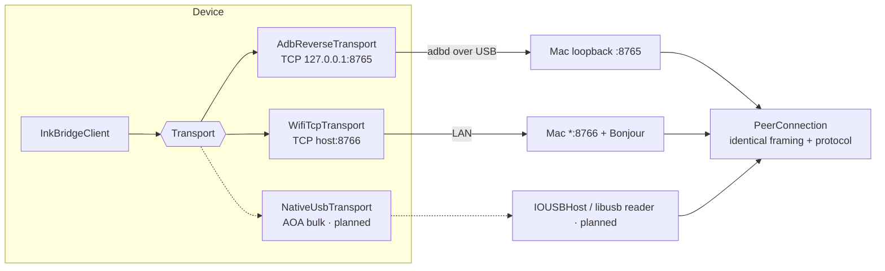

# Transport architecture

The drawing engine never learns which transport delivered a message. The `PeerInfo.kind`
tag exists only for the UI and for `PeerArbiter`'s preference.

## Device side

`Transport` (Kotlin) is a single-use byte pipe: `connect`, `send(frame payload)`,
`incomingMessages(): Flow<ByteArray>`, `disconnect`, and `connectionState`.
`TcpTransport` implements it with a blocking `Socket`:

- `tcpNoDelay = true`. Nagle's algorithm would hold small stroke frames for up to
  ~40 ms waiting to coalesce them.
- `keepAlive = true`, as a backstop. Liveness really comes from protocol pings.
- A dedicated reader thread decodes frames into an unbounded channel. Its EOF or
  exception is the disconnect signal.
- Writes go through a `BufferedOutputStream` flushed per frame, under a mutex.

`AdbReverseTransport` and `WifiTcpTransport` are `TcpTransport` with fixed
endpoints. They differ only in address and `kind`.

## Host side

`InkServer` runs two `NWListener`s on one serial queue:

| Listener | Bind | Auth | Discovery |
|----------|------|------|-----------|
| USB | `127.0.0.1:8765` (`requiredLocalEndpoint`) | none: only processes on this Mac can reach it, and `adb reverse` delivers the tablet there | — |
| Wi-Fi | `*:8766` | HMAC challenge; per-IP lockout after 5 failures in 60 s (30 s, doubling to 15 min); handshake timeouts count as failures | Bonjour `_inkbridge._tcp` |

Each accepted `NWConnection` becomes a `PeerConnection`. It handles framing, decoding,
the handshake state machine (`connecting → awaitingHello → ready → closed`), the
5 s handshake timeout, 2 s pings, the 7 s idle timeout, and per-peer `ClockSync`.
Wi-Fi can be switched off at runtime, which also drops Wi-Fi peers. Changing the
pairing code drops Wi-Fi peers that were paired with the old one.

## Choosing between transports

`PeerArbiter` makes exactly one peer active, and only its strokes are drawn:

- `preferUSB` (default): any USB peer beats any Wi-Fi peer. Within one kind, the
  newest connection wins, so a reconnecting tablet replaces its own stale socket
  immediately instead of waiting for the idle timeout.
- `usbOnly` / `wifiOnly`: as named.

When the active peer changes, strokes in progress are committed as they are, so
nothing dangles. Sequence de-duplication per `stream_id` (protocol §5) is a second
line of defence against double rendering.

Following the brief, **automatic mid-session failover is deliberately limited** to
this "active peer changes, finish the in-flight stroke" behaviour. The tablet app
connects over one transport at a time, chosen by the user. A tablet that holds both
links at once, with seamless handover, is future work, and would need the device to
replay the open stroke's `stroke.begin` on the new link.

## Development USB vs. production USB

See [`research/usb-research.md`](../research/usb-research.md) and
[`ADR-002`](../decisions/ADR-002-usb-transport.md). `adb reverse` is the MVP transport
and needs USB debugging. **AOA (Android Open Accessory) protocol v2 was verified
on the Note Air 3** with debugging off. That is the planned production path, and it
needs no protocol changes: AOA provides a bulk byte stream that carries the same
frames.

## Reconnection targets

| Event | Mechanism | Measured |
|-------|-----------|----------|
| Host drops the TCP connection | client backoff (250 ms first retry) | integration test asserts < 3 s; typically about 250–400 ms on loopback |
| Host unreachable | retries capped at 2 s | unit tested |
| Cable unplug and replug (adb) | `adb reverse` rules are cleared by adbd on disconnect; `scripts/adb-usb.sh` reapplies them | **not yet hardware verified** |
| Wi-Fi blip | same as the first row | **not yet hardware verified** |
